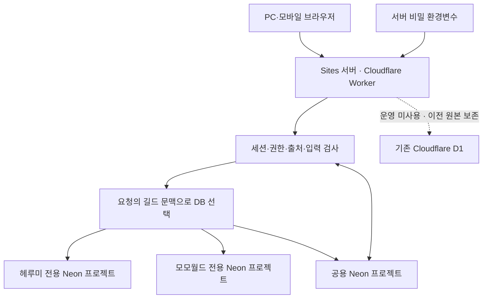
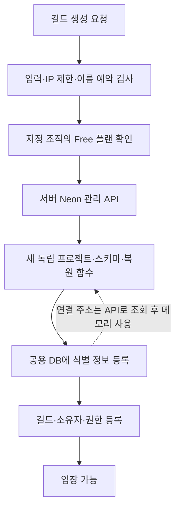

# 캣히어로 길드 분배 — DB 구조·보안·정합성·안정성 검사

> 검사일: 2026-10-13 (Asia/Seoul)  
> 대상: [운영 사이트](https://xn--2o2b17v91girj.kro.kr)와 기본 호스팅 주소  
> 운영 배포: Sites v96, 소스 커밋 `01a412f43bcbaa53044e233185586fb7fc561b74`  
> 범위: 길드 분배 사이트. 별도 커뮤니티 저장소 `cathero_comm`은 대상이 아니다.

## 1. 결론

접속, 두 길드의 조회 로그인, 상태·활동·시세·복원 기록 조회, 조회 사용자 저장 차단이 실제 운영 주소에서 통과했다. 저장 후 재조회, 수정 충돌, 활동 작성·취소는 분리된 Neon 검증 브랜치에서 실제 서버 처리 코드와 PostgreSQL로 통과했다.

이전 직전 원본과 운영 Neon의 **업무 데이터 25개 테이블 단위 비교가 모두 일치**했다. 로그인 검사로 생긴 세션·시도 기록 증가는 업무 데이터 손실과 구분했다.

보안과 안정성은 **보완사항이 있는 조건부 정상**으로 판정한다. 검사 범위에서 인증 우회나 운영 데이터 노출은 재현되지 않았지만, 익명 길드 생성의 무료 DB 한도 소진 위험, HTML 속성 처리, 조회 중 파생 시세 저장, 해시 강도, 구성 변경 시 구 DB로 되돌아가는 경로가 남아 있다. 전체 자동 테스트는 **109개 중 103개 통과, 6개 실패**이며, 같은 실패가 Neon 이전 코드에서도 재현된다. 가격·확률 계산까지 완전히 검증됐다는 의미는 아니다.

이 보고서는 점검 결과다. 검사 중 운영 애플리케이션 기능을 수정하거나 실제 길드의 작성·정산 데이터를 테스트 값으로 바꾸지 않았다. 조회 API에 원래 존재하는 파생 시세 갱신 경로와 검사용 로그인 세션 생성은 별도로 고려했다.

## 2. DB 연결 구조

### 2.1 운영 요청 경로



브라우저는 사이트의 동일 출처 API만 호출한다. DB 연결 주소·비밀번호와 Neon 관리 API 키는 서버 비밀 환경변수에 있고, 브라우저에 전달하지 않는다. PostgreSQL 연결은 서버의 `@neondatabase/serverless` HTTP 드라이버를 사용한다. 현재 운영 설정은 `NEON_BACKEND=active`이며, 이전 중 저장 제한은 해제되어 있다.

**공용 DB에는 시세만 있는 것이 아니다.** 길드 목록, 권한, 인증·세션, 일부 서비스 요청과 연결 메타데이터도 공용 DB에 있다. 길드 업무 기록의 물리적 분리와 모든 서비스 데이터의 완전한 분리는 다르다.

| 저장 위치 | 주요 테이블 | 역할 |
|---|---|---|
| 공용 Neon | `market_prices`, `item_attributes` | 공용 시세·아이템 속성 |
| 공용 Neon | `guild_workspaces`, `guild_access` | 길드 목록·권한 |
| 공용 Neon | `local_credentials`, `local_sessions`, `guild_passwords`, `guild_password_attempts` | 비밀번호 해시·세션·로그인 시도 |
| 공용 Neon | `price_requests`, `sheet_requests`, `sheet_bindings` | 시세·시트 요청과 시트 중복 연결 방지 |
| 공용 Neon | `workspace_backups`, `neon_guild_projects` | 이전 보존 기록·새 길드 프로젝트 식별 정보 |
| 각 길드 Neon | `guild_state`, `activity_points`, `sheet_sync` | 길드 상태·분배 이력·활동·동기화 상태 |
| 각 길드 Neon | `support_questions`, `improvement_suggestions` | 해당 길드 질문·제안 |
| 각 길드 Neon | `guild_snapshots`, `guild_audit`, `restore_guard` | 복원 기록·변경 이력·복원 중 보호 |
| 각 길드 Neon | `migration_identity`, 로컬 `guild_workspaces` 사본 | DB 식별·관리 조회용 길드명 |
| 기존 D1 | 이전 데이터 | 운영용 원본 보존. 새 Neon 기록과 자동 동기화하지 않음 |

초기 설정의 미사용 `guild_database_registry`에는 연결 문자열을 저장하지 않는다. 실제 검사에서도 행 수가 0이었다. `neon_guild_projects`는 프로젝트·브랜치·DB·역할 식별 정보와 생성 상태를 저장하며 연결 비밀번호를 저장하지 않는다. 생성 중 재시도를 위한 비밀번호 해시는 생성 완료 시 비운다.

### 2.2 새 길드 생성



현재 조직 플랜은 실제 조회에서 `free`였다. 코드는 유료 조직에서 새 길드 생성을 거절하고, 생성 시 최소·최대 컴퓨트를 0.25 CU로 지정한다. 생성에 실패하면 같은 이름·비밀번호로 이어갈 수 있고, 중복 생성 방지용 예약과 임시 잠금을 사용한다.

새 길드 생성 경로는 자동 테스트 4개로 검증했다. 이번 감사에서는 운영에 가짜 길드나 새 프로젝트를 만들지 않았으므로 **실제 운영 프로젝트 생성의 종단간 시험은 미실시**다.

### 2.3 복원 영향 범위

| 조작 | 영향 |
|---|---|
| 해당 길드의 앱 스냅샷 복원 | 해당 길드 상태와 활동 취소 표시를 복원. 수정 번호를 확인해 충돌을 방지 |
| 해당 길드 Neon 프로젝트 복원 | 해당 길드 전용 DB에만 영향. 다른 길드 프로젝트·공용 시세는 별도 |
| 공용 Neon 전체 복원 | 시세뿐 아니라 공용 인증·세션·길드 목록·새 프로젝트 연결 메타데이터에도 영향 |
| 기존 D1로 운영 설정 변경 | 최신 Neon 기록이 없는 이전 사본으로 접속할 위험. 일반적인 롤백 방법으로 사용하면 안 됨 |

앱 스냅샷은 최근 **30건**, 변경 이력은 **300건** 보관 기준이다. “30일 백업”이 아니다. 전체 Neon JSON 백업은 내보내기 기능이며, 전체 DB의 원클릭 JSON 가져오기까지 시험한 것은 아니다. DB 전체 복원과 앱의 길드 스냅샷 복원은 구분해야 한다.

## 3. 실제 사이트 동작 검사

기본 호스팅 주소와 사용 중인 도메인에서 두 길드를 각각 조회 권한으로 로그인했다.

| 항목 | 결과 |
|---|---|
| 홈페이지·길드 목록 접속 | 200 |
| 조회 권한 로그인 | 두 길드 모두 200 |
| 길드 상태 조회 | 두 길드 모두 200 |
| 활동·공용 시세 조회 | 두 길드 모두 200 |
| 복원 기록·질문·제안·시트 상태 조회 | 두 길드 모두 200 |
| 조회 사용자의 상태 저장 시도 | 403, 차단 |
| 이전용 임시 데이터 추출 경로 | 404, 폐기됨 |

비밀번호를 임의 변경하거나 운영 소유자 세션을 위조해 시험하지 않았다. 운영 소유자 비밀번호로 직접 로그인해 브라우저에서 입력·저장하는 시험과 모바일 시각 검사는 미실시다. 플랫폼 제공 브라우저 검증 수단이 없어 HTTP 검사·클라이언트 초기화 테스트로 범위를 한정했다.

### 3.1 작성·저장 시험

운영과 다른 기존 Neon 검증 브랜치에서 가상 길드원과 빈 창고를 사용했다. 실제 `app/api/state/route.ts`, `app/api/activities/route.ts`, 길드 범위 처리와 PostgreSQL 어댑터를 실행했다. 로그인은 테스트 문맥으로 대체했고, 빈 창고의 시세 변환 함수는 대체했으므로 이 시험이 시세 계산·브라우저 인증까지 검증한 것은 아니다.

| 시험 | 결과 |
|---|---|
| 유효한 상태 저장 | 200, 수정 번호 +1 |
| 저장 후 다시 읽기 | 저장한 가상 길드원·수정 번호 일치 |
| 이전 수정 번호로 재저장 | 409, 충돌 방지 |
| 잘못된 상태 입력 | 400 |
| 다른 출처의 저장 | 403 |
| 활동 작성 | 200, 횟수 2 × 단위 5 = 점수 10 |
| 활동 취소 | 200, 취소 표시 확인 |
| 비로그인 상태 조회 | 401 |

이 시험의 쓰기는 검증 브랜치에만 발생했다. 실제 두 길드 상태를 테스트 값으로 덮어쓰지 않았다. 앞선 전환 검증에서는 운영 DB의 복원 함수를 트랜잭션 안에서 실행한 뒤 강제로 되돌려, 수정 번호와 복원 보호 기록이 원래 상태로 유지됨도 확인했다.

## 4. DB 정합성 검사

이전 직전 D1 체크포인트는 2026-10-13 **00:43:53 KST**다. 이번 감사의 DB 비교를 시작한 시각은 **01:16:22 KST**이며, 각 DB를 반복 가능한 읽기 트랜잭션으로 검사했다. 서로 다른 프로젝트 전체를 동시에 묶는 전역 트랜잭션은 아니다.

| 위치 | 주요 현재 행 수 |
|---|---|
| 공용 | 길드 2, 권한 2, 시세 86, 아이템 속성 40, 인증 3 |
| 헤루미 | 상태 1, 활동 22, 변경 이력 244, 복원 기록 30, 시트 상태 1 |
| 모모월드 | 상태 1, 활동 0, 변경 이력 6, 복원 기록 6, 시트 상태 1 |
| 두 길드 | 질문 0, 제안 0, 복원 보호 기록 0 |

업무 데이터 **25개 테이블 비교**에서 원본 행 누락 0, 값 변경 0, 추가 업무 행 0이었다. 원본의 모든 기존 필드를 키별로 비교했고, PostgreSQL 정수 표현 차이는 문자열 값으로 정규화했다. 인증 해시가 포함된 원본은 비교에만 사용했으며 문서·GitHub에 올리지 않았다.

세션은 원본 4건에서 비교 시점 12건으로, 시도 기록은 19건에서 21건으로 증가했다. 검사 로그인으로 생성된 운영 기록이며, 원본 행 누락·값 변경은 없었다. 세션·시도 기록 수는 이후 로그인과 만료 정리에 따라 달라진다.

| 정합성 항목 | 결과 |
|---|---|
| DB의 고정 길드 식별값 | 두 길드 모두 일치 |
| 다른 길드 ID를 가진 업무 행 | 0 |
| 저장 상태의 서버 유효성 검사 | 두 길드 모두 통과 |
| 활동 점수와 횟수 × 단위 점수 불일치 | 0 |
| 현재 상태보다 미래인 스냅샷 수정 번호 | 0 |
| 복원 보호 기록 잔류 | 0 |
| 스냅샷 30건·변경 이력 300건 제한 | 통과 |
| 길드 ID 고정 CHECK 제약 | 두 길드에서 확인 |
| 자동 상태 변경·활동 백업·활동 이력 트리거 | 각 길드 3개 확인 |
| 소속 길드가 없는 인증 / 인증 없는 세션 | 각각 0 |
| 연결 비밀번호를 담은 미사용 레지스트리 행 | 0 |
| 시트 연결 중복 | 등록 1건, 고유 시트 1건 |

헤루미 활동 1건은 현재 길드원 명단에 없는 과거 인원의 기록이다. 원본과 동일하고 점수 계산도 정상이다. 이전 손상으로 판정하지 않았으며 이력 보존을 위해 삭제하지 않았다. 실제 탈퇴·명단 정리와 일치하는지는 운영자가 확인할 사항이다.

## 5. 보안 검사 기준과 결과

### 5.1 이전 프롬프트 처리

이전에 사용한 보안 프롬프트 **원문은 확인되지 않았다**. 기존 `SECURITY.md`의 2026-10-10 검사 기준을 읽고 아래 기준을 재구성했다. 같은 원문을 그대로 재사용했다거나 독립된 여러 검사자가 검토했다고 주장하지 않는다.

> 인증·세션·역할·길드 격리·관리 API 권한·입력 검증·CSRF·XSS·SQL 파라미터·비밀값·백업·의존성·복원 및 동시 저장을 검사한다. 운영 데이터에 공격성 테스트 값을 넣지 않는다. 소스 검토, 자동 테스트, 실제 HTTP 검사, 격리된 DB 시험의 증거를 구분한다. 심각도와 성립 조건, 재현 여부, 남은 한계와 개선안을 기록한다. 추정만으로 취약점 없음 또는 모든 기능 정상이라고 단정하지 않는다.

### 5.2 운영 HTTP 보안 검사 — 9 / 9 통과

| 항목 | 실제 응답 |
|---|---|
| 홈페이지와 보안 응답 헤더 | 200, 헤더 확인 |
| 비로그인 상태 데이터 조회 | 401 |
| 비로그인 전체 백업 다운로드 | 401 |
| 가짜 세션 쿠키 | 401 |
| 다른 출처의 길드 생성 요청 | 403 |
| JSON이 아닌 요청 | 415 |
| 허용 크기를 넘는 게이트웨이 요청 | 413 |
| cross-site 메타데이터 요청 | 403 |
| 폐기된 이전용 추출 경로 | 404 |

응답에 DB 연결 문자열, 비밀번호 해시, 회원 원본 JSON, 스택 정보가 포함되는 패턴은 발견되지 않았다. 이는 검사한 응답에 대한 결과이며 모든 가능한 에러 응답의 완전한 증명은 아니다.

실제 홈페이지에서 CSP의 스크립트 nonce, HSTS, `nosniff`, 출처 정책, 장치 권한 제한과 `private, no-store`를 확인했다. 해당 응답에 느슨한 CORS 허용 헤더는 없었다.

### 5.3 비밀값·의존성

- 최종 스캔: 소스 236개·Git 이력 블롭 655개에서 개인 키와 주요 토큰 패턴 발견 0. 검사 도구의 탐지 규칙에 한정된 결과다.
- DB 접속 비밀번호 형태를 별도 검사했으며 발견 위치는 가상 테스트 주소가 있는 `tests/neon-management.test.mjs`뿐이었다.
- 실제 DSN, API 키, 비밀번호·해시·세션 쿠키 값, 원본 사용자 데이터는 이 보고서에 포함하지 않았다.
- 운영 의존성 감사: Critical / High / Moderate / Low 모두 **0**.
- 개발 의존성 포함 감사: **High 1**, `braces` 3.0.3 관련 `GHSA-vfj7-8cjw-p6xm`. 운영 의존성 검사에는 포함되지 않았고, 검사일의 공식 권고문에 패치 버전은 없다.
- Semgrep·Gitleaks 전용 엔진, 브라우저 기반 공격 시험, 지속적인 침투 테스트는 수행하지 않았다.

## 6. 발견사항과 우선순위

심각도는 이 애플리케이션의 확인된 성립 조건을 기준으로 작성했다. 잠재 영향과 실제로 재현한 결과를 구분한다.

| ID | 분류·우선순위 | 근거와 영향 | 권장 조치 |
|---|---|---|---|
| SEC-01 | 높음·가용성 / P1 | `/api/guilds`의 익명 생성 요청이 서버 관리 키로 독립 프로젝트를 생성한다. IP당 제한은 있으나 전역·일별 생성 한도, 승인, 봇 방어는 없다. 분산 요청이 Free 프로젝트 한도를 소진할 수 있다. 소스에서 성립 조건을 확인했으며 실제 한도 소진 공격은 미실시 | 전역 예약 수·생성 속도 한도, 중복 요청 보호, 봇 방어 또는 승인, 실패 프로젝트 관리 추가. 자동 유료 전환으로 해결하지 않기 |
| SEC-02 | 중간·화면 입력 / P1 | `validState`는 따옴표 포함 ID를 허용하고 일부 회원·아이템 ID와 선택적 기여도 값을 HTML 속성에 직접 삽입한다. 로컬 가상 입력에서 검증 통과와 비이스케이프 소스를 확인했다. 저장된 마크업 삽입 가능성이 있으며 nonce CSP는 인라인 스크립트 실행을 제한한다. 브라우저에서 실행되는 XSS까지 입증한 것은 아니다 | 모든 속성 값 이스케이프 또는 DOM API 사용, 선택적 숫자 필드 검증. 기존 ID 호환성을 고려한 회귀 테스트 |
| SEC-03 | 중간·읽기 경계 / P2 | `lib/market.ts:getCatalog`가 GET 조회 중 `rawDatabase`로 파생 시세를 저장한다. 원시 시세 임의 편집이 허용된다는 뜻은 아니지만, 조회 사용자 요청도 파생 행을 갱신할 수 있어 “조회는 쓰기 없음”이라는 경계가 성립하지 않는다. 이번 원본 비교에서 시세 변경은 없었다 | 조회에서는 계산값만 반환하고, 저장은 승인된 관리·갱신 경로로 분리하거나 명시적 시스템 캐시로 정의 |
| SEC-04 | 중간·비밀번호 / P2 | 현재 PBKDF2-HMAC-SHA256은 100,000회이고 비밀번호 최소 길이는 6자다. OWASP의 현재 PBKDF2 권고 반복 수보다 낮아 해시 유출 시 오프라인 추측 방어를 강화할 여지가 있다 | 해시 버전·반복 수 필드와 로그인 시 점진적 재해시 도입. 기존 해시를 일괄 변경해 로그인을 깨뜨리지 않기 |
| OPS-01 | 중간·복구·설정 / P1 | `NEON_BACKEND`가 정확히 `active`가 아니면 D1 경로를 사용한다. 현재는 정상이나 설정 누락·오타로 이전 DB를 다시 쓰면 데이터가 갈라질 수 있다 | 이전 완료 후 운영 환경은 설정 오류 시 실패하도록 보호. 보존 D1을 최신 Neon의 자동 대체 DB로 사용하지 않기 |
| OPS-02 | 중간·복원 범위 / P2 | 인증·세션·연결 메타데이터는 공용 DB에 있다. 공용 DB 전체 복원이 모든 길드의 공용 서비스에 영향을 줄 수 있다 | 길드 복원과 공용 복원 절차 분리, 연결 메타데이터 백업·복구 계획 유지 |
| QA-01 | 중간·가격 계산 / P1 | 전체 테스트 6건 실패. 같은 이름의 실패가 Neon 이전 커밋에서도 재현되어 이전으로 새로 생긴 실패는 아니다. 그래도 가격·확률 계산 결과의 완전한 정확성을 보장할 수 없다 | 실제 기준 확률·시세·기대값을 재확정해 구현과 테스트를 함께 정합화 |
| DEP-01 | 개발 환경 High / P2 | `braces` 권고문 및 전체 의존성 감사 결과. 운영 요청에서의 악용 경로는 확인되지 않았다 | 신뢰하지 않는 glob 입력 제한, CI·빌드 격리, 패치·상위 의존성 업데이트 추적 |
| ARCH-01 | 설계상 한계 / P2 | 실제 PostgreSQL 테이블 RLS는 활성화되지 않았다. 현재는 서버 권한 검사, 요청별 DB 선택, 길드 고정 CHECK에 의존한다 | 최소 권한 DB 역할과 DB 차원 방어 검토. RLS만 켜면 소유자 연결까지 자동 보호된다고 가정하지 않기 |

확인된 인증 우회나 비밀값 노출을 위 표와 동일시하지 않는다. 단일 감사에서 Critical 공격을 재현하지 않았다고 해서 미래 코드·플랫폼·계정까지 안전함이 보장되지는 않는다. 이번 요청은 검사·문서화이므로 위 개선사항은 운영에 일괄 적용하지 않았다.

## 7. 안정성·테스트·검사 한계

| 항목 | 결과 |
|---|---|
| 전체 Node 테스트 | 109개: 통과 103 / 실패 6 |
| 보안·격리·복원·클라이언트·Neon 관련 선택 검사 | 앞선 전환 검사 26개 통과, 전체 검사에서도 해당 실패 없음 |
| TypeScript `--noEmit` | 통과 |
| 감사 스크립트 JavaScript 문법 | 통과 |
| 현재 배포 빌드 | v96 빌드·배포 성공 |
| PostgreSQL 5분 초과 쿼리 | 공용·두 길드 모두 0 |
| 헤루미 DB의 관측 시점 잠금 | 0 |
| 실제 운영 HTTP 보안 요청 | 9 / 9 통과 |
| 격리 DB 실제 저장 처리 | 통과 |

기존 실패 6개는 `armor-scope` 1개, `expected-value-audit` 3개, `valuation` 2개다. 이전 커밋 `a5dfe0db`에서 해당 세 파일을 별도 디렉터리로 실행했을 때도 동일한 여섯 이름이 실패했다. “기존 실패”는 해결됐다는 뜻이 아니다.

보안 HTTP 요청의 검사 환경 경과 시간은 최소 5.513초, 중앙값 9.868초, 최대 14.872초였다. 원격 실행 환경·네트워크 프록시가 포함되어 실제 한국 모바일 사용자의 응답 시간이나 서버 자체 처리 시간을 나타내지 않는다. 부하 시험·장시간 가용성 측정·브라우저 입력부터 자동 저장까지의 전체 성능 측정은 하지 않았다.

현재 운영 소스는 Sites에서 배포된 커밋이다. GitHub `cathero_guild/main` 조회에서는 `db/neon.ts`가 확인되지 않았다. **이 보고서 업로드가 운영 소스 전체의 GitHub 동기화나 배포를 의미하지 않는다.** 운영 코드와 GitHub 소스를 맞추는 작업은 별도 확인이 필요하다.

### 7.1 재검사 기준

실제 운영 소스 체크아웃에서 다음을 재실행한다.

```bash
node scripts/security-scan.mjs
node --test tests/*.test.mjs
node node_modules/typescript/bin/tsc --noEmit
pnpm audit --prod
pnpm audit
```

추가로 운영 HTTP의 비로그인·조회 권한·출처·크기 제한을 확인하고, 지정된 격리 브랜치에서 저장·충돌·활동 처리를 검사한다. 운영 데이터는 의도적 시험 입력으로 대체하지 않는다. 자격 증명은 비밀 입력으로만 공급하며 로그·보고서·Git에 기록하지 않는다. 전체 테스트 실패는 개수를 포함해 그대로 기록한다.

## 8. 근거와 참고자료

- 운영 소스: `db/neon.ts`, `db/raw.ts`, `lib/neon-management.ts`, `lib/neon-sql.mjs`, `lib/guild-sql.mjs`
- 보안·세션·입력: `lib/security-policy.mjs`, `lib/local-auth.ts`, `lib/password-crypto.mjs`, `lib/state-validation.mjs`
- 조회·저장·복원: `lib/market.ts`, `public/app.js`, `app/api/state/route.ts`, `app/api/activities/route.ts`, `app/api/recovery/route.ts`
- 이전·복원 스키마: `migrations/neon/`
- 이전 검사 기준: 운영 소스의 `SECURITY.md` (2026-10-10)
- [OWASP Password Storage Cheat Sheet](https://cheatsheetseries.owasp.org/cheatsheets/Password_Storage_Cheat_Sheet.html): PBKDF2-HMAC-SHA256 600,000회 권고 확인
- [GitHub Advisory GHSA-vfj7-8cjw-p6xm](https://github.com/advisories/GHSA-vfj7-8cjw-p6xm): 개발 의존성 경고 근거

이 문서에는 연결 비밀번호, API 키, 로그인 비밀번호·해시·쿠키, 개인 길드원 이름, 원본 백업 JSON을 포함하지 않는다.

